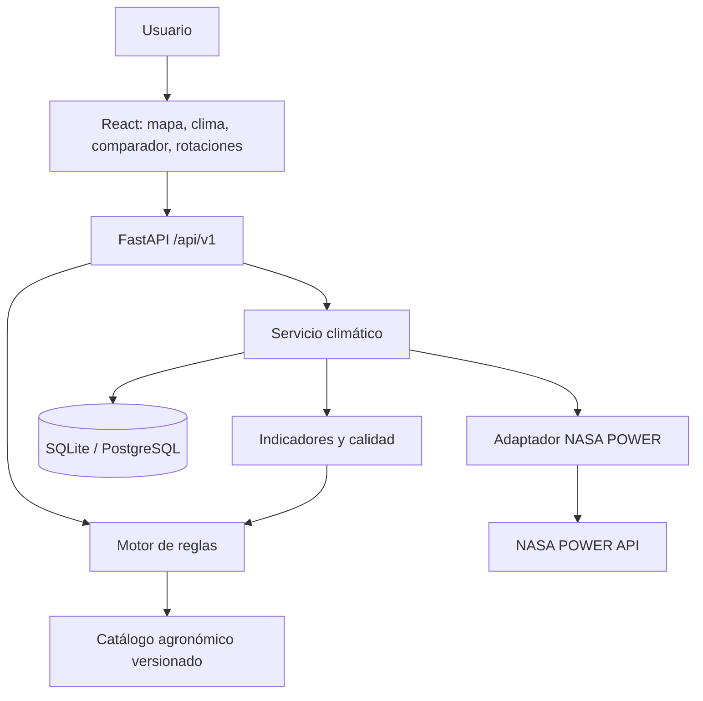

# AgroNexa — Especificación de requisitos y guía de implementación

**Versión:** 1.0 | **Fecha:** 21 de noviembre de 2026 | **Área:** Ciencia de Datos  
**Proyecto:** Plataforma web de apoyo a la planificación de rotaciones agrícolas mediante datos de observación terrestre de la NASA en la región andina del Perú.  
**Estado de partida:** formulación e investigación; ningún componente de software se considera implementado o probado.  
**Destinatarios:** equipo de desarrollo, Codex y asesor académico.

## 0. Instrucciones para Codex

Este archivo es la especificación principal del producto. Implementar incrementalmente, no generar todo de una sola vez. Antes de editar, inspeccionar el repositorio, identificar código existente, comprobar versiones y presentar un plan breve. Si no existe código, iniciar desde la fase 0. No cambiar tecnologías o contratos sin documentar la decisión. No inventar datos NASA, fuentes científicas, capturas, resultados ni pruebas. Los ejemplos de este archivo son especificaciones, no evidencia de ejecución. Registrar avances reales en `docs/PROGRESS.md` y decisiones en `docs/DECISIONS.md`. Todo módulo debe tener pruebas y estados de error. Priorizar un flujo completo con datos reales frente a una interfaz extensa que no funcione.

## 1. Contexto y visión del producto

La agricultura altoandina enfrenta variabilidad de temperatura y lluvia, disponibilidad desigual de agua y necesidad de conservar el suelo. La información ambiental existe en diversos portales, pero su interpretación requiere conocimientos técnicos. AgroNexa propone reunir datos ambientales, información aportada por usuarios y criterios agronómicos documentados, para comparar condiciones y explorar alternativas de rotación. La primera versión estudia papa y quinua en zonas de Puno, Cusco y Arequipa. El sistema es de apoyo a decisiones: no prescribe siembras, no reemplaza a agrónomos y no predice rendimientos exactos.

**Objetivo general:** desarrollar una plataforma web que integre, procese y visualice datos ambientales de NASA, y los conecte con criterios agronómicos transparentes para apoyar la planificación agrícola.

**Objetivos técnicos:** (1) ingestión reproducible de series históricas; (2) limpieza y agregación de datos; (3) comparación geográfica y temporal; (4) ficha agrícola de contexto; (5) evaluación explicable y trazable de alternativas; (6) pruebas, documentación y evidencias reproducibles.

### 1.1 Usuarios y escenarios

- Agricultor o técnico: consulta una localidad, revisa condiciones históricas e indica cultivo anterior, agua y prioridades.
- Estudiante o investigador: compara zonas en un periodo común, descarga datos y examina procedencia y limitaciones.
- Equipo mantenedor: configura localidades y reglas documentadas, comprueba calidad y actualiza fuentes. No se requiere panel administrativo ni autenticación en el MVP local.

Historia principal: «Como usuario, quiero seleccionar una zona, consultar su clima histórico, compararlo con otra zona y explorar opciones de rotación con explicaciones, para preparar una decisión que pueda contrastar con un especialista».

## 2. Alcance y prioridades

| Prioridad | Entrega |
|---|---|
| P0 — imprescindible | Selección de localidades, consulta real NASA POWER, caché, indicadores de temperatura y precipitación, comparación, mapa, exportación CSV, ficha agrícola y evaluación de reglas con abstención por falta de evidencia. |
| P1 — después de P0 | Importación controlada de GPM IMERG, SMAP o MODIS; historial de escenarios persistente, mejoras de accesibilidad, despliegue público. |
| P2 — futuro | Cuentas, mapas raster, polígonos de parcelas, cultivos adicionales, modelos predictivos validados, integración de estaciones locales. |

Fuera de alcance: predicciones de productividad, diagnóstico de enfermedades, irrigación automatizada, recomendaciones definitivas, fertilidad medida desde satélite, mapas que representen precisión de parcela no disponible, entrenamiento de IA por obligación. No añadir pagos ni autenticación innecesaria.

## 3. Decisiones de arquitectura

Monorepo cliente-servidor. React + TypeScript + Vite, Tailwind CSS, React Leaflet y Recharts. Backend Python 3.11, FastAPI, Pydantic, HTTPX, Pandas, NumPy, SQLAlchemy 2 y Alembic. SQLite para desarrollo y demostración de un único proceso; PostgreSQL como opción de despliegue mediante `DATABASE_URL`. Pytest para backend; Vitest y Testing Library para frontend. Dependencias fijadas por lockfile o archivo de versiones; comprobar compatibilidad real antes de elegir versiones. No incorporar microservicios, colas, Redis o Docker como prerrequisitos; Docker Compose opcional después de la ejecución local.



El navegador nunca llama a NASA directamente. Backend valida parámetros, consulta caché, recupera series, normaliza datos y devuelve información estructurada. Las reglas agronómicas no se mezclan con componentes UI. Los cálculos se implementan como funciones puras probables de manera aislada. Los adaptadores P1 implementarán un contrato común, sin acoplar el motor a un proveedor específico.

## 4. Estructura del repositorio

```text
agronexa/
  AGENTS.md
  README.md
  .env.example
  .gitignore
  docs/
    AGRONEXA_ESPECIFICACION_TECNICA.md
    PROGRESS.md
    DECISIONS.md
    DATA_DICTIONARY.md
    AGRONOMIC_SOURCES.md
    EVIDENCE.md
  backend/
    requirements.txt
    alembic.ini
    migrations/
    app/
      main.py
      core/             # configuración, logging, excepciones
      api/v1/           # routers
      schemas/          # contratos Pydantic
      db/               # sesión y modelos
      repositories/     # persistencia
      providers/        # nasa_power, importadores P1
      services/         # climate, quality, indicators, comparison
      domain/           # rotation, reglas y evaluación
      seed/             # localidades y reglas verificadas
    tests/
  frontend/
    package.json
    src/
      app/              # rutas, layout y proveedores
      pages/
      components/       # UI reutilizable
      features/         # climate, compare, rotation, map
      api/              # cliente y tipos
      hooks/
      styles/
    tests/
  data/
    catalog/            # localidades y criterios con fuentes
    fixtures/           # datos sintéticos solo para pruebas
    cache/              # ignorado por Git
  scripts/              # seed, precarga, verificación y demo
```

No crear carpetas vacías por cumplir estructura; incorporar cuando se necesiten. Mantener límites claros y evitar duplicar la lógica de cálculo en cliente y servidor.

## 5. Requisitos funcionales y aceptación

| ID | Requisito | Aceptación verificable | Prioridad |
|---|---|---|---|
| RF-01 | Listar localidades con región, latitud, longitud y fuente. | Selector y mapa coinciden; ubicación no validada tiene etiqueta explícita. | P0 |
| RF-02 | Seleccionar fechas y localidad. | Rechaza fecha invertida, futura o intervalo fuera de rango; permite fechas inclusivas. | P0 |
| RF-03 | Consultar NASA POWER. | Backend recupera serie diaria, conserva metadatos y unidades; no devuelve números ficticios ante error. | P0 |
| RF-04 | Normalizar y almacenar series. | Duplicados no incrementan conteo; sentinel y valores inválidos se convierten en faltantes. | P0 |
| RF-05 | Indicadores y gráficos. | Muestra temperatura media, mínima/máxima diaria agregada, precipitación total y cobertura, con periodo y unidades. | P0 |
| RF-06 | Comparar 2–3 localidades. | Mismo periodo, variables, método y unidades; diferencias de cobertura y límites visibles. | P0 |
| RF-07 | Mapa interactivo. | Marcadores seleccionables, zoom, coordenadas, atribución cartográfica; sin falso mapa de calor. | P0 |
| RF-08 | Ficha agrícola. | Seleccionar cultivo anterior y candidato, disponibilidad de riego, datos opcionales de suelo y prioridades. | P0 |
| RF-09 | Evaluar alternativas. | Devuelve criterios, evidencia, versión, cobertura y estado; no asigna puntuación si faltan datos críticos. | P0 |
| RF-10 | Exportar CSV. | Descarga serie normalizada con fechas, localidad, unidades, fuente y valores vacíos cuando faltan. | P0 |
| RF-11 | Consultar procedencia y limitaciones. | Pantalla de metodología incluye enlaces, resolución, periodo, advertencias y fecha de consulta. | P0 |
| RF-12 | Estados de carga/error/sin datos/caché. | Se muestran mensajes y opción de reintento; caché antigua queda identificada. | P0 |
| RF-13 | Importar fuente adicional. | Adaptador verificado, metadatos y pruebas antes de habilitar capa/indicador. | P1 |
| RF-14 | Guardar escenarios. | Persistencia con identificador, fecha y versión de reglas; se puede recuperar. | P1 |

## 6. Requisitos no funcionales

- RNF-01 Accesibilidad: interfaz español, navegación por teclado, contraste AA como objetivo, etiquetas y mensajes asociados a inputs; no depender únicamente del color.
- RNF-02 Adaptabilidad: diseño para escritorio y móviles desde 360 px, sin scroll horizontal en la página; tablas pueden desplazarse dentro de su contenedor.
- RNF-03 Rendimiento objetivo: respuesta de caché p95 menor a 2 s en entorno de prueba documentado (no resultado obtenido); llamada externa con timeout 20 s, reintentos acotados, UI de progreso. Medir y reportar condiciones.
- RNF-04 Seguridad: validar todos los inputs, allowlist de orígenes CORS, consultas parametrizadas, proveedor URL fija, secretos en variables de entorno; no exponer tokens ni trazas internas. No almacenar datos identificables de agricultores para el MVP.
- RNF-05 Integridad: resultados reproducibles con periodo, fuente, reglas y versiones; ninguna sustitución silenciosa de datos faltantes.
- RNF-06 Mantenibilidad: módulos pequeños, tipos TS sin `any` injustificado, validación Pydantic, lint, tests y README de arranque desde cero.
- RNF-07 Disponibilidad demo: precarga legítima de datos NASA y reutilización offline claramente señalada; sin simular consultas exitosas.
- RNF-08 Privacidad: ficha anónima, coordenadas únicamente de localidades públicas en P0; advertir antes de guardar o exportar escenarios.

## 7. Zonas y periodo de estudio

Catálogo inicial ilustrativo para iniciar consultas, no delimita campos agrícolas. Confirmar coordenadas con fuente oficial/local y documentarla antes de exponer. Valores aproximados de centros de localidad:

| ID | Localidad | Región | Latitud | Longitud |
|---|---|---|---:|---:|
| puno-ilave | Ilave | Puno | -16.09 | -69.64 |
| cusco-urubamba | Urubamba | Cusco | -13.30 | -72.12 |
| arequipa-chivay | Chivay | Arequipa | -15.64 | -71.60 |

Periodo por defecto: 2021-01-01 a 2025-12-31 (cinco años completos); permitir rangos de 1 a 3660 días sujeto a disponibilidad del proveedor. Para la primera prueba usar 2024 completo; 366 días esperados. Fecha final nunca posterior al día actual; distinguir retrasos de publicación de faltantes. El análisis de periodo histórico no constituye pronóstico. No inferir altitud ni características de suelo desde las coordenadas. P0 usa localidades predefinidas, no consultas arbitrarias del mapa.

## 8. Fuentes, adquisición y tratamiento

### 8.1 NASA POWER — integración inicial

Documentación: https://power.larc.nasa.gov/docs/services/api/temporal/daily/  
Endpoint fijo: `https://power.larc.nasa.gov/api/temporal/daily/point`.

Consulta de ejemplo (comprobar contra servicio real antes de dar por válida):

```bash
curl "https://power.larc.nasa.gov/api/temporal/daily/point?parameters=T2M,T2M_MIN,T2M_MAX,PRECTOTCORR&community=AG&longitude=-69.64&latitude=-16.09&start=20240101&end=20241231&format=JSON&time-standard=LST"
```

| Parámetro | Descripción | Unidad esperada (confirmar metadatos) |
|---|---|---|
| T2M | Temperatura del aire a 2 m, media diaria | °C |
| T2M_MIN | Temperatura mínima diaria a 2 m | °C |
| T2M_MAX | Temperatura máxima diaria a 2 m | °C |
| PRECTOTCORR | Precipitación corregida, diaria | mm/día |

Leer `properties.parameter` y mapas fecha YYYYMMDD → valor; conservar sección de parámetros, encabezado, geometría y metadatos disponibles. Confirmar unidad y valor de relleno según respuesta; NASA POWER usa habitualmente -999 para relleno. No asumir que todos los productos tienen igual resolución. Para variables meteorológicas, la malla de POWER suele ser del orden de decenas de km (aprox. 0.5° × 0.625° para productos meteorológicos MERRA-2, verificar producto vigente). Un punto representa una celda, no una estación o parcela. Usar LST consistentemente y no interpretar como hora civil local.

### 8.2 Pipeline de datos

1. Validar localidad y fechas; construir solicitud con parámetros permitidos.
2. Buscar caché por fuente, localidad/coordenadas, parámetros, periodo y estándar temporal. Para el MVP puede consultarse/cachearse el intervalo exacto; usar upsert por día para almacenar observaciones.
3. Consultar proveedor con HTTPX. Timeout 20 s; máximo 2 reintentos para 429, timeouts y 5xx, con backoff y respeto acotado de Retry-After; no reintentar 4xx permanentes.
4. Validar HTTP, esquema JSON, variables y unidades; persistir metadatos y hash SHA-256 de respuesta original si se conserva. No admitir HTML o JSON malformado como dato.
5. Crear calendario completo inclusivo; transformar fechas y valores; convertir sentinels, NaN, infinito, lluvia negativa y datos fuera de reglas de calidad documentadas a nulos o flags (no corregir datos sin registro). Señalar incoherencia min > max o media fuera de rango min/max; no descartar otras variables válidas automáticamente.
6. Guardar observaciones de forma idempotente. Si se usa caché antigua, informar fecha y estado, sin mezclar fuentes sin etiqueta. Intervalo cerrado histórico: TTL inicial 30 días; periodo reciente (últimos 30 días): 24 h. Configurables.
7. Agregar indicadores y devolver serie ordenada junto con calidad y trazabilidad. No interpolar valores en MVP.

### 8.3 Fuentes complementarias P1

| Fuente | Datos | Consideración |
|---|---|---|
| GPM IMERG Final Run | Precipitación | Seleccionar producto diario/mensual, aprox. 0.1°; verificar versión, unidad (tasa vs acumulado), acceso y latencia. No sumar tasas sin convertir. https://gpm.nasa.gov/data/imerg |
| SMAP | Humedad superficial o radicular según producto | Productos de diferente resolución, p. ej. 9/36 km; verificar variable, flags y unidad volumétrica. No equivale a fertilidad. https://smap.jpl.nasa.gov/ |
| MODIS MOD13Q1 | NDVI/EVI de 16 días, 250 m nominales | Aplicar factor de escala y QA del producto; no convertir composiciones a observaciones diarias inventadas. https://modis.gsfc.nasa.gov/ |
| AppEEARS | Extracción de productos por puntos/áreas | Herramienta de acceso, no una variable; puede exigir Earthdata Login. https://appeears.earthdatacloud.nasa.gov/ |
| INIA / MIDAGRI / SENAMHI | Agronomía, calendarios y clima local | Investigar documentos específicos, página y contexto regional. https://www.gob.pe/inia ; https://www.gob.pe/midagri ; https://www.senamhi.gob.pe/ |

Estas direcciones son referencias técnicas; la disponibilidad de cada producto y la descarga efectiva se verificarán al implementar. Earthdata: https://www.earthdata.nasa.gov/ y https://urs.earthdata.nasa.gov/. No automatizar acceso con credenciales incrustadas. P1 admite importación local de archivo real con manifiesto de origen como alternativa a una API.

## 9. Indicadores y reglas de calidad

Sea N el número de días calendario del intervalo y n los registros válidos de una variable. Cobertura = 100 × n / N. Computar por variable y por agrupación (mes, año, periodo completo). Usar un umbral inicial de calidad de 90% configurable, una decisión de ingeniería no agronómica.

- Temperatura media: suma de T2M válidos / n; mostrar n, N y cobertura.
- Temperatura mínima absoluta del periodo: mínimo de T2M_MIN válidos; máxima absoluta: máximo de T2M_MAX válidos. Si se muestra media mensual de mínimas/máximas, etiquetar diferente.
- Precipitación acumulada: suma de PRECTOTCORR diaria válida. Si faltan días, mostrar «acumulado observado parcial»; nunca presentarlo como total completo ni completar con cero. Para comparación de totales definitivos exigir cobertura 100% en todas las localidades; en caso contrario, mostrar parcial y advertencia.
- Días con helada meteorológica potencial: conteo de T2M_MIN ≤ 0 °C, opcional si hay datos; no equivale a helada observada en cultivo. Mostrar cobertura.
- Días con lluvia: conteo de PRECTOTCORR ≥ 1 mm/día, umbral descriptivo configurable; no es regla agronómica.
- Comparación: diferencia A−B en la misma variable, periodo y método; habilitar cuando cobertura suficiente y declarar diferencias en días válidos; para medias comparativas preferir intersección de fechas válidas y mostrar n común. Si no hay cobertura suficiente, sin diferencia numérica.
- Agrupar por meses calendario, conservar fecha ISO. No redondear antes de calcular; redondear presentación a 1 decimal y cobertura a 1 decimal. Valores ausentes = JSON null.

Ejemplo sintético de prueba: temperaturas [10, null, 14] → media 12 °C; cobertura 66.7%; lluvia [2, null, 3] → 5 mm observados parciales, no 5 mm totales. El dashboard debe advertir insuficiencia. No usar estas cifras como datos del Perú.

## 10. Motor de evaluación de rotaciones

P0 debe tener un motor transparente basado en reglas, no un modelo ML. Las alternativas de referencia a explorar son papa → quinua, quinua → papa y, si se documenta, descanso u otro cultivo complementario. No afirmar que una secuencia es universalmente conveniente. El usuario elige cultivo anterior, candidatos y periodo histórico de referencia; el sistema debe aclarar que la aptitud histórica no pronostica la siguiente campaña.

### 10.1 Ficha de entrada

`location_id`, `previous_crop` (potato, quinoa, other, unknown), `candidate_crops` (lista), `irrigation` (available, limited, none, unknown), `soil_texture` (sand, loam, clay, other, unknown), `soil_ph` opcional (0–14 si realmente medido), `soil_notes` opcional (máximo 500 caracteres), `priorities` (agua, conservación de suelo, adaptación climática), fechas de referencia. No exigir pH o tipo de suelo a quien no los conoce. No inferir nutrientes, enfermedades o riego desde POWER.

### 10.2 Catálogo de reglas

Cada regla: id, versión, cultivo aplicable, secuencia aplicable, criterio, variable, operador, umbral/rango si procede, unidad, periodo temporal, peso, criticidad, fuente (URL, título, página o sección), contexto geográfico, estado (draft/reviewed/approved), fecha de revisión y nota de limitación. No activar drafts. No crear umbrales agronómicos arbitrarios. Si el catálogo carece de reglas aprobadas, la evaluación devuelve estado `insufficient_evidence`, con explicación, no un ranking falso. La aprobación significa revisión documentada por el equipo/asesor competente y no equivale a validación de campo.

### 10.3 Algoritmo

Para cada candidato: seleccionar reglas aprobadas aplicables; evaluar condición de cada regla con datos disponibles → `pass`, `fail`, `unknown`, `not_applicable`; registrar valor, unidad, fuente y explicación. Los criterios no aplicables se excluyen del denominador y los desconocidos siguen en el cálculo de cobertura de evidencia.

Cobertura de evidencia = suma de pesos de criterios evaluables / suma de pesos aplicables. Puntuación exploratoria = 100 × suma de pesos de criterios superados / suma de pesos evaluables. Pesos iniciales iguales solo cuando cada criterio tenga respaldo y el equipo documente que la ponderación es una convención exploratoria. No mostrar puntuación si no hay criterios evaluables, falta criterio crítico, o cobertura < 0.8 (umbral de evidencia de software, configurable). Una falla crítica devuelve `restriction_detected`; no recomendar como primera opción. Si existe evidencia suficiente, ordenar por puntuación, resolver empates como empate y mostrar incertidumbre. No llamar a la puntuación probabilidad de éxito. No comparar puntuaciones entre esquemas de criterios materialmente distintos sin advertencia.

Estados: `insufficient_evidence`, `restriction_detected`, `exploratory_comparison`. Cada resultado incluye `rule_set_version`, fecha/periodo, lista de criterios, cobertura, score nullable, advertencias y fuente. En pruebas, se permiten reglas sintéticas con etiqueta TEST exclusivamente en fixtures. Para la demo, si no hay regla agronómica revisada, mostrar alternativas sin ranking numérico y explicar qué evidencia hace falta.

## 11. Modelo de datos lógico

Usar claves internas, timestamps UTC y migraciones reproducibles. No persistir innecesariamente respuestas crudas con datos personales. SQLite debe activar foreign_keys; usar tipos portables a PostgreSQL.

| Entidad | Campos principales | Restricciones |
|---|---|---|
| Location | id, name, region, latitude, longitude, coordinate_source, verified | id único; lat [-90,90], lon [-180,180] |
| Dataset | id, provider, product, version, resolution_text, temporal_standard, documentation_url | identidad de producto/versionado |
| Variable | id, dataset_id, code, unit, description | UNIQUE(dataset_id, code) |
| FetchRun | id, location_id, dataset_id, start_date, end_date, request_key, fetched_at, status, metadata_json, response_hash | índice por request_key y fetched_at; fechas válidas |
| Observation | id, location_id, variable_id, date, value nullable, quality_flag, fetch_run_id | UNIQUE(location_id, variable_id, date); índice por localidad y fecha |
| Crop | id, name_es, description, source_url nullable | código estable |
| RuleSet | id, version, status, reviewed_at | versiones inmutables una vez aprobadas |
| Rule | id, rule_set_id, crop_id, previous_crop_id nullable, criterion, predicate_json, weight, critical, source_json, status | peso positivo; reglas aprobadas con fuente |
| Scenario (P1) | id, location_id, input_json, created_at, rule_set_id, result_json | snapshot para reproducibilidad; sin datos identificables |

El caché debe garantizar coherencia: guardar solicitud exitosa y sus observaciones en una transacción; no marcar una consulta como completa hasta persistirla; al usar observaciones actualizadas indicar la procedencia más reciente por dato y no prometer una instantánea histórica si no se conserva. Si se requieren reproducciones exactas de una corrida, conservar su snapshot/hash y versión como evidencia. Evitar reemplazar observaciones válidas por nulos causados por errores de ingesta. No modelar todos los indicadores derivados como tablas; calcular a partir de observaciones en P0.

## 12. API REST y contratos

Prefijo `/api/v1`. JSON UTF-8, fechas ISO `YYYY-MM-DD`, números sin NaN, enum estable, OpenAPI generado y documentación `/docs`. Responder errores con `code`, `message` en español y `details` no sensibles.

| Método y ruta | Entrada | Respuesta esperada |
|---|---|---|
| GET /health | ninguna | estado de proceso y base, sin probar NASA en cada llamada |
| GET /locations | ninguna | catálogo de localidades |
| GET /climate/series | location_id, start, end | serie diaria, metadatos, calidad |
| GET /climate/summary | location_id, start, end, group_by=month/year/period | indicadores agregados |
| GET /climate/compare | location_ids (repetible, 2–3), start, end | indicadores alineados, diferencias y advertencias |
| GET /climate/export | location_id, start, end | CSV UTF-8 con Content-Disposition |
| GET /crops | ninguna | catálogo de cultivos |
| POST /rotations/evaluate | ficha de sección 10 | resultados explicados, fuentes, versión |
| GET /sources | ninguna | catálogo, estado de integración y limitaciones |

`/health` vive fuera del prefijo; los demás endpoints dentro. HTTP 422 para parámetros inválidos; 404 para localidad inexistente; 502 por respuesta upstream no válida; 503 por indisponibilidad externa sin caché; 504 por timeout agotado si no hay caché. Una serie genuinamente sin observaciones puede ser HTTP 200 con cobertura 0 y advertencia. No devolver 200 inventando valores. La UI debe manejar estos estados.

Ejemplo de forma de respuesta (valores nulos ilustrativos, no datos descargados):

```json
{
  "location_id": "puno-ilave",
  "period": {"start": "2024-01-01", "end": "2024-01-01"},
  "source": {"provider": "NASA POWER", "product": "daily point", "fetched_at": null, "cache_status": "illustrative", "time_standard": "LST"},
  "units": {"t2m": "degC", "t2m_min": "degC", "t2m_max": "degC", "prectotcorr": "mm/day"},
  "series": [{"date": "2024-01-01", "t2m": null, "t2m_min": null, "t2m_max": null, "prectotcorr": null}],
  "quality": {"expected_days": 1, "valid_days_by_variable": {"t2m": 0, "t2m_min": 0, "t2m_max": 0, "prectotcorr": 0}},
  "warnings": ["Ejemplo de contrato, sin datos reales"]
}
```

El enum real de caché incluirá `fresh`, `cached`, `stale`; `illustrative` solo documenta el ejemplo. La respuesta de resumen contiene agregados `{value, unit, valid_days, expected_days, coverage_pct, status}` por indicador y grupo; `status` puede ser `complete`, `partial`, `insufficient`, `no_data`. La respuesta de comparación contiene `locations`, `aligned_period`, `comparisons`, `warnings`. El CSV usa columnas date, location_id, t2m_deg_c, t2m_min_deg_c, t2m_max_deg_c, prectotcorr_mm_day, source, fetched_at, quality_flags; valores nulos vacíos; escapar texto según CSV y evitar fórmulas inyectadas. Definir esquemas Pydantic y tipos TS concordantes; agregar tests de contrato.

## 13. Diseño de interfaz y navegación

Principio visual: interfaz profesional de análisis ambiental, limpia, inspirada en sistemas GIS, evitar estética de videojuego. Paleta sugerida: verde bosque #123E32, verde #29966D, fondo #F4F7F5, texto #182D27, acento agua #2675B8, alerta #B45309. Verificar contraste. Tipografía sans-serif legible, consistente, sin dependencia obligatoria de fuentes externas. Formatear etiquetas y números en es-PE, conservar ISO en API.

| Ruta | Pantalla y componentes |
|---|---|
| / | Inicio: propósito, zonas de estudio, CTA Explorar clima, estado de fuentes, acceso a metodología. No mostrar cifras sin consultas. |
| /explorar | Selector región/localidad, rango de fechas, mapa con marcadores, tarjetas de temperatura/lluvia, dos gráficos, cobertura, botón CSV. |
| /comparar | Selección de 2–3 localidades y periodo común, tabla comparativa, líneas por zona, barras de lluvia mensual, leyendas, alertas de calidad. |
| /rotaciones | Formulario en pasos: zona y periodo, cultivo anterior y candidatos, agua y suelo, resultados con evidencia y explicación. |
| /metodologia | Origen, resolución, diferencias entre productos, algoritmos, reglas, enlaces y limitaciones. |

Navegación persistente, sidebar en escritorio y menú accesible en móvil. Mantener filtros en URL cuando resulte sencillo. No introducir login ni landing comercial. Cada tarjeta debe indicar unidad, intervalo, fuente y calidad; usar guion para nulo, no cero. Gráficos con huecos para datos faltantes, sin unir líneas sobre ausencias; evitar doble eje confuso. Mapas centrados en sur del Perú, puntos identificados; usar OpenStreetMap con atribución y respetar política de tiles; no precargar masivamente. Si tiles caen, mostrar coordenadas y selector funcional. Mostrar tabla alternativa para usuarios de lectores de pantalla. Leyendas y tooltip sin ocultar información crítica.

Flujo de demo principal: seleccionar Ilave → 2024 → consultar → revisar media y lluvia → comparar con Urubamba y Chivay → exportar → abrir rotaciones → revisar estado y fuentes. Toda página necesita estados inicial, cargando, éxito, vacío, error y caché desactualizada si aplica. No renderizar resultados de una solicitud anterior como si correspondieran a filtros nuevos; cancelar solicitudes obsoletas o usar ID de petición.

## 14. Configuración y ejecución local

Codex debe crear y verificar instrucciones para Windows PowerShell y Linux/macOS. Ejemplo de comandos esperados (ajustar a los archivos que efectivamente genere):

```powershell
cd backend
py -3.11 -m venv .venv
.\.venv\Scripts\Activate.ps1
python -m pip install -r requirements.txt
python -m alembic upgrade head
python -m uvicorn app.main:app --reload --port 8000
```

En otra terminal:

```powershell
cd frontend
npm ci
npm run dev
```

Si aún no existe lockfile, usar `npm install` inicialmente y versionar el lockfile; luego `npm ci`. Usar Node LTS compatible con Vite. Backend `http://localhost:8000`; frontend `http://localhost:5173`; configurar proxy de Vite o CORS explícito. `.env.example` documentará `DATABASE_URL`, `NASA_POWER_BASE_URL` (valor fijo oficial; no controlado por usuario), `CORS_ORIGINS`, `NASA_TIMEOUT_SECONDS=20`, `CACHE_TTL_HOURS=720`, `RECENT_CACHE_TTL_HOURS=24`, `MIN_DATA_COVERAGE=0.90`, `MIN_RULE_COVERAGE=0.80`, `LOG_LEVEL`, `VITE_API_BASE_URL`. No versionar `.env`, bases locales, credenciales Earthdata ni caché. Scripts de precarga permiten descargar datos reales para las tres zonas y un periodo, emiten manifiesto con fecha/fuente/hashes y errores. No depender de credenciales para ejecutar tests. Documentar seed y migraciones idempotentes.

## 15. Plan de pruebas y evidencia científica

| Caso | Verificación |
|---|---|
| T01 | Fechas invertidas, futuras, fuera del rango y coordenadas inválidas se rechazan. |
| T02 | Año bisiesto 2024 contiene 366 días; calendario incluye inicio y fin. |
| T03 | Adaptador interpreta JSON de fixture, metadatos, sentinel -999 y variables ausentes. |
| T04 | Reingestión no duplica; fallo de proveedor no corrompe caché. |
| T05 | Media, mínimos/máximos, lluvia y cobertura coinciden con cálculo manual sintético. |
| T06 | Lluvia incompleta queda parcial; no se compara como total completo. |
| T07 | Comparación usa rango y método común; avisa por cobertura desigual. |
| T08 | Timeout, 429, 5xx, JSON inválido y caída de red producen estados controlados. |
| T09 | Caché stale muestra antigüedad; sin caché retorna error explícito. |
| T10 | Motor sin reglas aprobadas, datos críticos ausentes o peso inválido se abstiene. |
| T11 | Reglas sintéticas prueban empate, falla crítica, desconocido y no aplicable. |
| T12 | CSV conserva unidades, fechas, faltantes y trazabilidad. |
| T13 | UI navega por teclado, valida formulario y funciona a 360/768/1440 px. |
| T14 | Prueba de integración opcional en vivo contra NASA POWER: registrar HTTP, fecha, esquema, cobertura y muestra. No asumir éxito. |
| T15 | Flujo completo local: consulta real o caché real identificada, comparación y evaluación. |

Tests unitarios deterministas sin internet por defecto; marcar pruebas de red por separado. Ejecutar `python -m pytest` y `npm run test` (definir script no interactivo), lint y `npm run build`. Registrar comandos, fecha, entorno, resultado y fallos pendientes. Para validación del análisis, contrastar agregados del sistema con cálculo independiente desde CSV. Para contraste externo, usar estaciones SENAMHI únicamente si se obtienen legalmente y están temporal/geográficamente alineadas; distinguir estación y celda y no declarar exactitud sin métricas reales. Si se evalúa usabilidad, registrar tamaño de muestra, tareas y resultados consentidos. No fabricar testimonios, métricas ni validación agronómica.

## 16. Plan de implementación incremental

Plazo orientativo para una demo el 27 de noviembre (confirmar disponibilidad y situación administrativa); si se inicia más tarde conservar el orden de dependencias, no el calendario.

| Fase | Fecha objetivo | Entrega y criterio de salida |
|---|---|---|
| 0 | 22 nov | Repositorio, configuración, health, README, catálogo de localidades. Arranque limpio verificado. |
| 1 | 22–23 nov | Adaptador POWER, prueba real, normalización, persistencia y caché. CSV/manifesto de al menos una consulta real si proveedor responde. |
| 2 | 23–24 nov | Indicadores, cobertura, comparaciones y API; tests con cálculo independiente. |
| 3 | 24–25 nov | Interfaz explorar y comparar, gráficos, mapa, exportación, estados UI. Flujo completo de clima. |
| 4 | 25–26 nov | Ficha y motor; catálogo agronómico documentado; evaluación o abstención explicable. Revisión de fuentes. |
| 5 | 26 nov | Pruebas, precarga real, capturas, README, despliegue opcional y ensayo. |
| P1 | Después | GPM/SMAP/MODIS, historial y ampliaciones. Solo si P0 está estable. |

Si hay tres integrantes: A — backend y coordinación; B — datos, indicadores y evidencia agronómica; C — frontend, UX y pruebas. Todos revisan ciencia y resultados. Si una sola persona desarrolla con Codex, ejecutar fases en secuencia. No invertir tiempo en auth, predicción ML o mapas raster antes de completar P0.

Definición de terminado por fase: código integrado, lint/build/tests ejecutados cuando corresponda, documentación actualizada, sin datos falsos en UI, limitaciones visibles, instrucciones de reproducción y lista de pendientes. Si alguna condición falla, indicar `in progress` o `blocked`, no `done`.

## 17. Riesgos y mitigación

| Riesgo | Mitigación |
|---|---|
| NASA API no disponible | Timeouts, caché legítima, precarga y reporte del incidente. |
| Resolución insuficiente en Andes | Etiquetar celda y contexto regional; no extrapolar a parcela. |
| Falta de reglas agronómicas válidas | Hacer abstención útil; investigar INIA y consultar especialista. |
| Plazo corto | Congelar P0, demostrar flujo real y evitar módulos ornamentales. |
| Dependencias incompatibles | Lockfiles, entorno aislado, pruebas de instalación, decisiones registradas. |
| Interpretación de score como prescripción | Etiqueta exploratoria, evidencia por criterio, sin probabilidad ni promesas. |

## 18. Entregables y actualización del informe académico

- Repositorio reproducible, README y especificación; esquema de arquitectura y modelo de datos actualizado.
- Aplicación local funcional (y URL pública solo si realmente desplegada), documentación de API.
- Dataset de demostración real, CSV, manifiesto de fuentes, periodo, fecha de descarga y calidad; fixtures aislados.
- Evidencias: capturas del sistema ejecutado, resultados de pruebas, tabla de indicadores verificados, limitaciones y reglas documentadas.
- Informe académico: conservar estructura Anexo 1. Actualizar metodología con tecnologías efectivamente usadas, resultados con evidencias y conclusiones con objetivos alcanzados. No declarar resultados pendientes como implementados. No es necesario mencionar el origen de la propuesta en otro evento.

## 19. Prompt inicial para Codex

```text
Lee AGENTS.md y docs/AGRONEXA_ESPECIFICACION_TECNICA.md completos.
Este es AgroNexa, un proyecto de Ciencia de Datos. Actualmente parte de
una propuesta conceptual. Inspecciona el repositorio antes de modificarlo.
Realiza únicamente la fase 0 y la implementación inicial de la fase 1
(NASA POWER con datos reales) según los contratos de la especificación.
Primero presenta un plan breve y luego implementa. Configura el entorno,
crea pruebas deterministas, ejecuta los comandos que sea posible ejecutar
y registra el resultado real en docs/PROGRESS.md. Si no puedes acceder a
NASA, implementa el manejo de errores y registra el bloqueo; no inventes
series ni presentes fixtures como datos reales. Al finalizar, explica cómo
arrancar el sistema en Windows y qué falta para completar la fase 1.
No implementes todavía módulos P1 ni inteligencia artificial.
```

Para cada fase siguiente: «Lee la especificación y PROGRESS. Revisa el código existente, corrige bloqueos críticos y completa la fase N con sus criterios de aceptación. Ejecuta pruebas, actualiza documentación y lista cambios reales». Pedir revisión de diferencias antes de cambios de arquitectura o dependencias grandes.

## 20. Fuentes y trazabilidad inicial

Documento base del equipo: *AgroNexa — Proyecto Estudiantil (Anexo 1), versión de seis páginas, noviembre de 2026*. De él provienen el problema, zonas, cultivos, objetivos, arquitectura general y alcance. Esta especificación añade decisiones técnicas propuestas, contratos, calidad, prioridades, fases y criterios de aceptación; no acredita ejecución.

Referencias para verificar durante el desarrollo: NASA POWER (https://power.larc.nasa.gov/), documentación API diaria (https://power.larc.nasa.gov/docs/services/api/temporal/daily/), GPM IMERG (https://gpm.nasa.gov/data/imerg), SMAP (https://smap.jpl.nasa.gov/), MODIS (https://modis.gsfc.nasa.gov/), Earthdata (https://www.earthdata.nasa.gov/), INIA (https://www.gob.pe/inia), MIDAGRI (https://www.gob.pe/midagri), SENAMHI (https://www.senamhi.gob.pe/). Registrar título, identificador/versión de producto, fecha de consulta y documentos agronómicos específicos antes de citar resultados. No se ha realizado una descarga de datos en la elaboración de esta guía.
